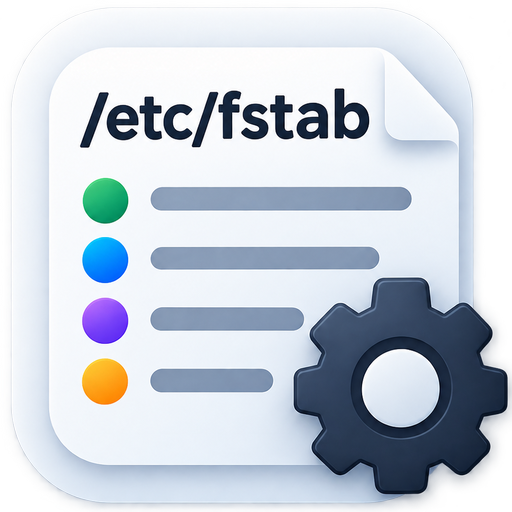
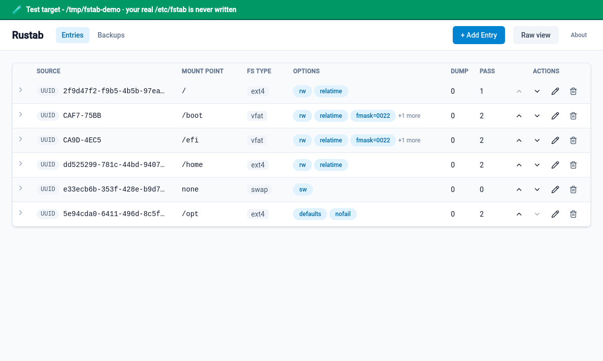
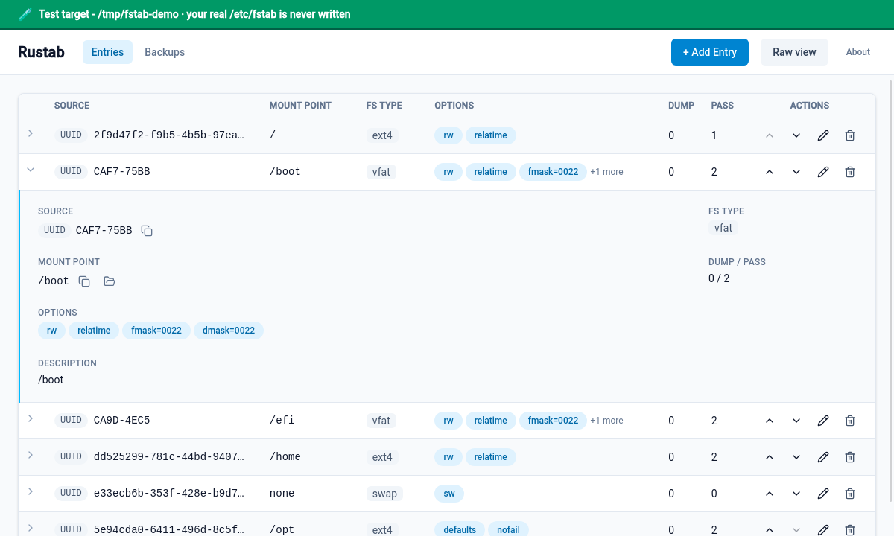
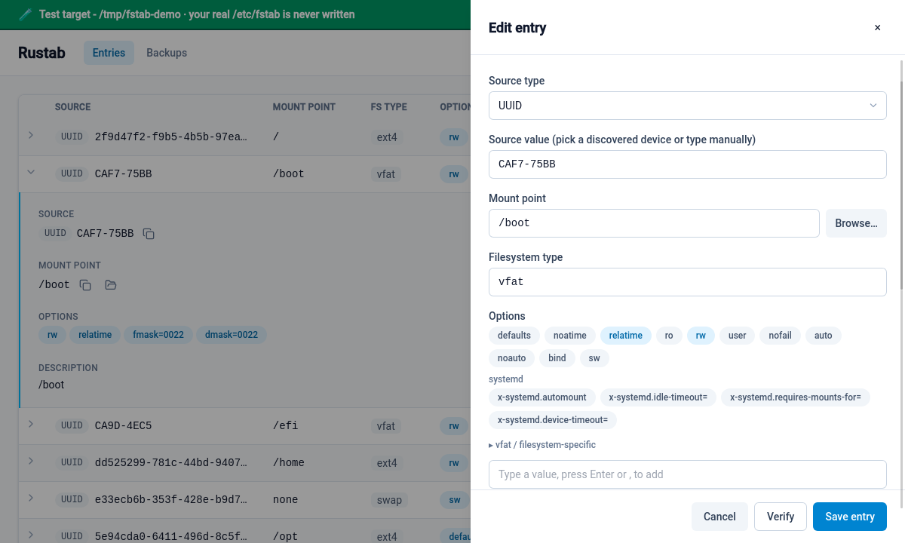
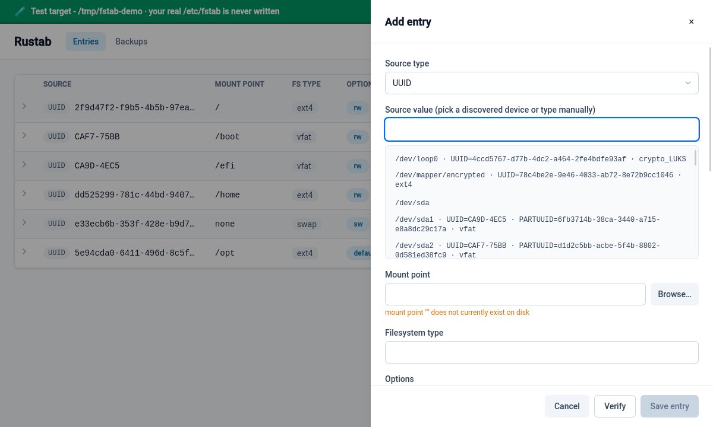
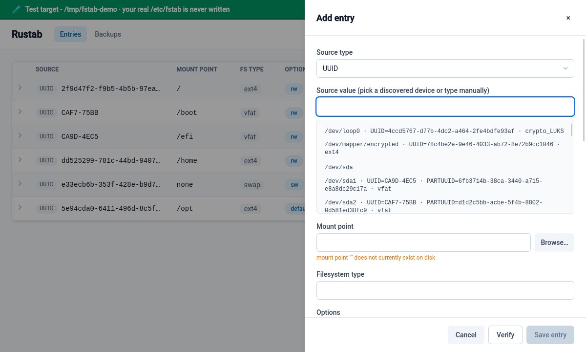
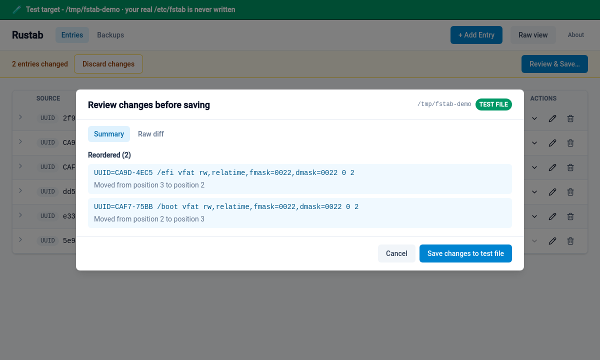
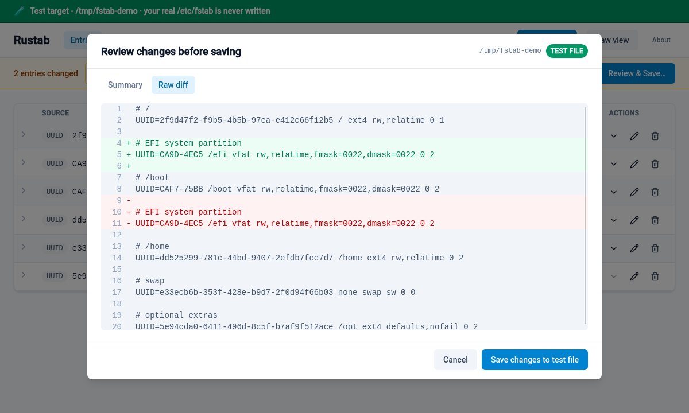

<p align="center">
  
</p>

<h1 align="center">Rustab</h1>

<p align="center"><b>A modern, safety-first GUI for editing /etc/fstab on Linux.</b></p>

<p align="center">View, edit, validate, and back up your fstab entries - atomic writes, automatic backups, and a mandatory diff review before anything touches your real <code>/etc/fstab</code>.</p>

<p align="center">
  
  <a href="https://github.com/t0msk/rustab/actions/workflows/ci.yml"></a>
  
  
</p>

<p align="center">
  <a href="https://discord.gg/vymDkeQnpj"></a>
  <a href="https://github.com/sponsors/t0msk"></a>
  <a href="https://x.com/TomskDEV"></a>
</p>

---

Rustab combines a clean, intuitive interface with a powerful safety-first architecture:
- **Full fstab syntax support**: UUIDs, LABELs, device paths, network sources, bind mounts, swap entries, systemd-generator options (`x-systemd.*`), comments - everything fstab and systemd support, round-tripping perfectly.
- **Atomic writes & automatic backups**: Every save uses write-ahead semantics with mandatory `findmnt --verify` validation, atomic filesystem rename, and automatic timestamped backups.
- **Mandatory diff review before every save**: see exactly what's changing in a side-by-side Summary or unified Raw view, with an explicit confirmation step, before anything reaches `/etc/fstab`.
- **A persistent working draft, not a throwaway sandbox**: your in-progress edits live in a local draft file that survives an app restart, so you never lose work mid-edit - and every save still writes straight to your real `/etc/fstab`, which is the whole point of the app.

## Contents

- [Features](#features)
- [Screenshots](#screenshots)
- [Roadmap](#roadmap)
- [Safety Notes](#safety-notes)
- [Installation](#installation)
- [Prerequisites](#prerequisites)
- [Building & Running](#building--running)
- [Testing](#testing)
- [License](#license)
- [AI Use Disclosure](#ai-use-disclosure)
- [Contributing](#contributing)
- [Contact & Support](#contact--support)

## Features

- **View and edit fstab entries** with a clean, modern table interface
- **Add, modify, or delete entries** with a structured form and inline validation feedback
- **Support for all fstab device identifiers**: raw device paths, UUID, LABEL, PARTUUID, PARTLABEL, and network sources
- **Advanced option handling**: toggles for common options, checklist/tag input for custom options, first-class support for `x-systemd.*` options
- **Device and mount-point pickers** for easier entry creation (via `lsblk`/`findmnt`; soft failure if tools unavailable)
- **Drag-and-drop (or button-based) entry reordering** - reorder entries by dragging a row, or with per-row Move up/down buttons
- **Mandatory diff review before saving** - see exactly what will change in a side-by-side Summary or unified Raw format, with a one-click "Discard changes" to revert all pending edits at once
- **Automatic backup management** - every save creates a timestamped backup; restore any previous state with one click
- **Comment and blank-line preservation** - your existing comments and formatting survive edits and round-trip without loss
- **Persistent working draft** - your in-progress edits survive restarting the app; the draft only gets overwritten from the real file if the real file itself changed since Rustab last looked
- **Privilege escalation gating** - an explicit confirmation checkbox and danger banner appear before every save, which always writes `/etc/fstab` through a single privilege-escalated (`pkexec`) call

## Screenshots

All screenshots below show Rustab pointed at a throwaway test file via `RUSTAB_TARGET_PATH` (see the green banner in each one) - never the real `/etc/fstab` - populated with real, reachable device identifiers from a real machine so every entry validates cleanly.

<table>
<tr>
<td width="50%">


<sub>**Main entries table** - source, mount point, filesystem type, options, and dump/pass at a glance, covering `UUID=`, `PARTUUID=`, `LABEL=`, `PARTLABEL=`, swap, and bind-mount sources.</sub>

</td>
<td width="50%">


<sub>**Row detail** - click any row to expand its full source, mount point, options, and description untruncated, in place.</sub>

</td>
</tr>
<tr>
<td width="50%">


<sub>**Editing an entry** - structured fields for every fstab column, with a device/mount-point picker and a tag-input for options.</sub>

</td>
<td width="50%">


<sub>**Adding an entry, with inline validation** - feedback (here, a mount point that doesn't exist yet) appears as you type, before you ever try to save.</sub>

</td>
</tr>
<tr>
<td width="50%">


<sub>**Device picker** - pick a real, currently-attached device instead of typing a UUID by hand.</sub>

</td>
<td width="50%">


<sub>**Review before saving - Summary view** - exactly what changed, grouped (here, a reorder), before anything touches disk.</sub>

</td>
</tr>
<tr>
<td width="50%">


<sub>**Review before saving - Raw diff view** - the same review step as a unified text diff, for anyone who prefers reading it that way.</sub>

</td>
<td width="50%">

</td>
</tr>
</table>

## Roadmap

Ideas for future versions, roughly ordered by how naturally they follow from what's
already built. None of these are committed or scheduled - this is a wishlist, not a
promise.

**Most natural next steps:**
- **Search/filter and column sorting** in the entries table - becomes genuinely useful
  once a real fstab has many entries (containers, lots of bind mounts).
- **systemd unit preview** - show what `systemd-fstab-generator` would actually
  produce for a given line, read-only, useful for debugging boot/mount behavior.

**Validation extensions** (all read-only checks, no live mount/unmount - see Safety
Notes and the project's own non-goals: Rustab edits the file, it doesn't act as a
mount manager):
- Cross-check a UUID/LABEL against currently attached devices (via `lsblk`) and warn
  if it doesn't match anything currently visible.
- Flag a removable/network source missing `nofail`/`noauto` - a common real-world
  mistake that can hang boot when the device isn't present.

**Workflow/productivity:**
- Guided templates for common entry types (swap, CIFS/NFS share, bind mount) instead
  of the generic blank form.
- Paste-to-import: paste a raw block of fstab lines (e.g. migrating from another
  system) and have them parsed into staged pending entries.
- Compare two backups against each other, not just a backup against the current file.

**Reach:**
- Finish and submit the Flathub packaging (see `docs/FLATPAK.md` - in progress).
- Additional UI languages beyond English.

**Bigger undertakings (real scope, not a quick win - flagged so nobody mistakes
these for an afternoon's work):**
- **True 3-way merge for "Reload and re-sync."** Today, resyncing during a save
  only moves the comparison baseline forward and leaves pending edits completely
  untouched (by design, see `PROJECT_PLAN.md` T37) - so any field you didn't
  personally edit in that session still gets overwritten by your own save,
  silently discarding whatever changed in the real file in the meantime. A real
  fix needs genuine three-way diffing (old baseline vs. the fresh external file,
  old baseline vs. your pending candidate), a reliable way to match entries
  across two documents that aren't guaranteed to have the same order or count
  (fstab entries have no stable ID today - matching would have to fall back to
  a heuristic like source+mount point, which itself needs a documented
  tie-breaking rule for duplicates), a new conflict-resolution UI for the case
  where the same field changed on both sides (something this app has never
  needed before), and new backend/DTO plumbing to carry per-field conflict
  state across the IPC boundary. Realistically comparable in size to this
  project's largest single features to date, not a drop-in change.

Have an idea not listed here, or want to weigh in on priority? Open an issue - see
[Contact & Support](#contact--support).

## Safety Notes

**Every save writes your real `/etc/fstab`:**

Rustab's purpose is editing the real `/etc/fstab`, and by default that is exactly what it does. It does not require any special environment variable to do so - a plain, unconfigured launch saves to `/etc/fstab`, through a single privilege-escalated (`pkexec`) helper call, with a mandatory confirmation step first (see below).

**A persistent local draft, kept in sync - not a separate "safe" target:**

Alongside the real file, Rustab keeps a local working draft at:

```
$XDG_DATA_HOME/rustab/fstab.draft
```

(falling back to `$HOME/.local/share/rustab/fstab.draft` if `$XDG_DATA_HOME` is not set).

This draft is what you're actually editing day to day - its job is to protect your in-progress edits across an app restart or crash, not to isolate you from the real file. On launch, Rustab checks whether `/etc/fstab` has changed since it last knew about it; if so, the draft is refreshed from the real file (your unsaved draft edits are only ever discarded when the real file has genuinely moved out from under you - e.g. you or another tool edited it outside Rustab). If nothing changed, your draft - including anything not yet saved - is left exactly as you left it. Every successful save writes `/etc/fstab` first, then updates this draft to match, so the two never drift apart under normal use.

**Before you save, review the diff.** Every save goes through a mandatory confirmation step: a side-by-side Summary or unified Raw diff of exactly what's about to change, an explicit checkbox, and a clearly red "Write to /etc/fstab" button - there is no accidental or silent write path.

**Backups are backups of the real file, too.** The Backups panel lists, creates, and deletes backups of `/etc/fstab` itself, not the local draft - so if your system won't boot, you can restore one from a rescue CD/USB straight onto the real file. By default (no `RUSTAB_TARGET_PATH`), creating or deleting a backup is a privileged operation: expect a `pkexec` prompt, same as a save.

**For development and testing without touching the real file**, point Rustab at a throwaway file instead via `RUSTAB_TARGET_PATH` - see `CONTRIBUTING.md`'s "Safety-first contribution notes" and `.env.example` in the repository root for details. Setting `RUSTAB_TARGET_PATH` to anything other than `/etc/fstab` makes that path the target outright, with no dual-write to the real file and no draft-mirroring involved.

## Installation

### Download a prebuilt package

Every [tagged release](https://github.com/t0msk/rustab/releases/latest) ships a `.deb`, `.rpm`, and `.AppImage` for **both x86_64 and ARM64** (built natively on each architecture, not cross-compiled or emulated - includes Raspberry Pi 4/5 and other 64-bit ARM boards running a 64-bit OS). Download the one matching your distro and CPU architecture and install it:

| Distro | Package | Install (x86_64) | Install (ARM64 / Raspberry Pi) |
| --- | --- | --- | --- |
| Debian / Ubuntu / Mint | `.deb` | `sudo apt install ./rustab_*_amd64.deb` | `sudo apt install ./rustab_*_arm64.deb` |
| Fedora / RHEL | `.rpm` | `sudo dnf install ./rustab-*.x86_64.rpm` | `sudo dnf install ./rustab-*.aarch64.rpm` |
| openSUSE | `.rpm` | `sudo zypper install ./rustab-*.x86_64.rpm` | `sudo zypper install ./rustab-*.aarch64.rpm` |
| Any Linux (portable, no install) | `.AppImage` | `chmod +x rustab_*_amd64.AppImage && ./rustab_*_amd64.AppImage` | `chmod +x rustab_*_aarch64.AppImage && ./rustab_*_aarch64.AppImage` |

(or just double-click the `.AppImage` in a file manager). `pkexec`/polkit is required at runtime regardless of install method - see [Prerequisites](#prerequisites).

### Distro package managers (coming gradually)

No native repo/store package exists yet for any of these - planned, and will be added gradually, not all at once:

| Channel | Status |
| --- | --- |
| Ubuntu PPA | Planned - work in progress |
| Debian repo | Planned - work in progress |
| Arch Linux (AUR) | Planned - work in progress |
| Fedora repo (Copr) | Planned - work in progress |
| Flathub | Planned - work in progress (see `docs/FLATPAK.md`) |

The detailed packaging plan for the PPA/Debian/AUR/Fedora channels - exact
steps, prerequisites, and current blockers - is tracked in
`docs/PACKAGING_DISTROS.md`.

### Build from source

See [Building & Running](#building--running) below.

## Prerequisites

You need:

- **Rust toolchain** (1.77.2 or later)
  - WASM target: `rustup target add wasm32-unknown-unknown`
- **Trunk** - build tool for Yew/WASM: `cargo install trunk` (verified: 0.21.14+)
- **Tauri CLI** - available as `cargo tauri` or via `cargo install tauri-cli` (verified: 2.2.7+)
- **Node.js** (dev-time only) - used by Trunk's pre-build hook to run Tailwind CSS via `npx`; nothing from `node_modules` ships in the final app or is needed at runtime
- **Linux system dependencies** for Tauri - see [Tauri's official Linux prerequisites documentation](https://v2.tauri.app/start/prerequisites/#linux); notably:
  - `libwebkit2gtk-4.1` and build tools (on Debian/Ubuntu: `libwebkit2gtk-4.1-dev`)
  - `libssl-dev`, `libgtk-3-dev`, and others (exact packages depend on your distro)
- **`pkexec` and polkit** - required for every save by default (writing to the real `/etc/fstab`), and for creating/deleting a backup; only unneeded when `RUSTAB_TARGET_PATH` points at a non-real file for development/testing (see Safety Notes)

## Building & Running

### Development

From the `src-tauri/` directory:

```bash
cargo tauri dev
```

This command automatically starts Trunk's dev server (which watches `frontend/src/` for changes and rebuilds on every save). The Tauri window will open with the compiled Yew frontend.

The workspace layout:
- `crates/fstab-core/` - pure Rust parser, validator, writer (zero GUI dependencies)
- `crates/rustab-privileged/` - GUI-free half shared by both binaries: the IPC DTOs and the elevated stdin/stdout protocol
- `crates/rustab-helper/` - the `rustab-helper` binary, statically linkable, run as root under `pkexec` by the Flatpak build (an ordinary install re-execs the GUI binary instead)
- `src-tauri/` - Tauri 2 application shell, command IPC layer, privilege escalation
- `frontend/` - Yew/WASM user interface (compiled via Trunk, not a workspace member due to target conflicts)

#### Troubleshooting: blank/white window on launch

If `cargo tauri dev` (or the built binary) opens a completely blank or white window instead of the UI, this is a known WebKitGTK issue on some GPU/driver combinations (common under certain Nvidia drivers, Wayland sessions, and virtual machines) - WebKitGTK's hardware compositing/DMA-BUF renderer fails silently instead of falling back. Force software rendering by setting these two environment variables before launching:

```bash
WEBKIT_DISABLE_COMPOSITING_MODE=1 WEBKIT_DISABLE_DMABUF_RENDERER=1 cargo tauri dev
```

If you're on a pure Wayland session and the window fails to open at all (rather than opening blank), also try forcing X11/XWayland:

```bash
GDK_BACKEND=x11 WEBKIT_DISABLE_COMPOSITING_MODE=1 WEBKIT_DISABLE_DMABUF_RENDERER=1 cargo tauri dev
```

### Release Build

From the `src-tauri/` directory:

```bash
cargo tauri build
```

This invokes `trunk build --release` to compile the frontend, then bundles everything into a single native Linux executable. Build artifacts are placed in `src-tauri/target/release/bundle/`.

### Tailwind CSS Build Step

Tailwind is run as a CLI tool (Node.js runtime only) via a pre-build hook in `frontend/Trunk.toml`. The compiled CSS is written to `frontend/styles/tailwind.css` and included in the final bundle. This step is automatic - no manual invocation needed.

This project uses Tailwind v4, which is configured from CSS rather than from a JavaScript config file: everything that used to live in `tailwind.config.js` (content globs, base-style overrides) is now in `frontend/styles/input.css`. The CLI itself ships as the separate `@tailwindcss/cli` package, which is why `frontend/package.json` declares two devDependencies.

## Testing

The repository includes an automated test suite covering the parser, validator, atomic writer, and frontend components:

**Workspace (Rust backend):**

```bash
cargo test --workspace
```

Runs 392 tests across:
- `crates/fstab-core`: 175 unit tests + 4 fixture-based integration tests
- `crates/rustab-privileged`: 47 DTO, backup-resolution and elevated-protocol tests
- `src-tauri/rustab_lib`: 166 command and privilege-escalation tests

**Frontend (Yew/WASM):**

```bash
cd frontend && cargo test
```

Runs 81 tests for components and diff logic (native Rust target, not WASM, so tests run on the host).

**Total:** 473 automated tests, all passing.

Run `cargo fmt --check` and `cargo clippy -- -D warnings` locally to catch style issues before committing. Both are gated in CI.

## License

Rustab is dual-licensed under the MIT License or the Apache License 2.0 - your choice. See `LICENSE-MIT` and `LICENSE-APACHE` at the repository root for full terms.

## AI Use Disclosure

Rustab's development made use of AI code assistance (Claude Code) to accelerate initial implementation. This is disclosed openly: the maintainer is a senior software developer with 10+ years of production experience, and personally code-reviewed and tested every change before merging. The codebase is backed by a comprehensive automated test suite (473 tests, all passing) in addition to manual review and repeated live testing of the real application through its documented entrypoint (`cargo tauri dev`). AI assistance was a development tool, not a replacement for professional engineering judgment or testing discipline.

## Contributing

See `CONTRIBUTING.md` for guidelines on setting up the dev environment, running tests, code style expectations, and the PR process. Contributors are asked to add themselves to `CONTRIBUTORS.md` in their PR.

## Contact & Support

- **Email**: [opensource@tomsk.dev](mailto:opensource@tomsk.dev)
- **Discord**: [Join the dev server](https://discord.gg/vymDkeQnpj)
- **X / Twitter**: [@TomskDEV](https://x.com/TomskDEV)
- **Sponsor**: [Support on GitHub Sponsors](https://github.com/sponsors/t0msk)

Have a question, found a bug, or want to contribute? Reach out on Discord or email - all are welcome.
